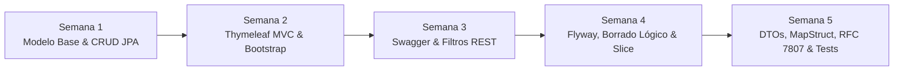

# 🚀 Eventify — Spring Boot HUs (Historias de Usuario)

Repositorio que documenta la evolución técnica, arquitectónica e incremental del proyecto **Eventify**, desarrollado a través de 5 Historias de Usuario (HUs) consecutivas basadas en el ecosistema **Spring Boot 4**, **Java 21** y las mejores prácticas del desarrollo backend empresarial.

🔗 **Repositorio oficial de GitHub:** [https://github.com/LeonardoFRNG/SpringBootHUs.git](https://github.com/LeonardoFRNG/SpringBootHUs.git)

---

## 📌 Tabla de Contenidos

- [Acerca del Proyecto](#-acerca-del-proyecto)
- [Stack Tecnológico](#-stack-tecnológico)
- [Estructura del Repositorio](#-estructura-del-repositorio)
- [Evolución Incremental por Semana](#-evolución-incremental-por-semana)
  - [Semana 1: Fundamentos y Modelo Base](#semana-1-fundamentos-y-modelo-base)
  - [Semana 2: Integración Web con Thymeleaf](#semana-2-integración-web-con-thymeleaf)
  - [Semana 3: OpenAPI, Swagger y Filtros](#semana-3-openapi-swagger-y-filtros)
  - [Semana 4: Diseño Relacional, Flyway y Optimización SQL](#semana-4-diseño-relacional-flyway-y-optimización-sql)
  - [Semana 5: Arquitectura Desacoplada, MapStruct y RFC 7807](#semana-5-arquitectura-desacoplada-mapstruct-y-rfc-7807)
- [Instalación y Ejecución](#-instalación-y-ejecución)
- [Endpoints Principales y Documentación](#-endpoints-principales-y-documentación)
- [Batería de Pruebas Automatizadas](#-batería-de-pruebas-automatizadas)
- [Autor](#-autor)

---

## 📖 Acerca del Proyecto

**Eventify** es una plataforma de gestión, categorización y catalogación de eventos y sedes (venues). Cada directorio en este repositorio representa una fase incremental del ciclo de vida del software, demostrando cómo una aplicación Spring Boot evoluciona desde un CRUD básico hasta una arquitectura modular desacoplada de nivel empresarial, con:

- **Desacoplamiento total** entre entidades JPA y contratos de entrada/salida mediante **DTOs** y **MapStruct**.
- **Control estricto de calidad de datos** con **Jakarta Bean Validation**, validador personalizado `@NoPastEvents` y grupos de validación (`OnCreate`, `OnUpdate`).
- **Manejo estandarizado de errores REST** bajo la especificación **RFC 7807 (Problem Details)** sin interferir en vistas MVC.
- **Rendimiento optimizado en base de datos** mediante proyecciones Java Record, paginación con `Slice`, resolución de N+1 en lotes y **borrado lógico** con `@SQLRestriction`.
- **Evolución del esquema relacional determinista** controlado por migraciones SQL versionadas con **Flyway**.
- **Panel administrativo visual** con **Thymeleaf**, **Bootstrap 5** y feedback visual de validación en tiempo real.

---

## 🛠 Stack Tecnológico

| Componente | Tecnología / Librería | Versión |
|---|---|---|
| **Lenguaje** | Java (OpenJDK LTS) | **21** |
| **Framework Base** | Spring Boot | **4.1.1** (Spring Framework 7.0.9) |
| **Persistencia & ORM** | Spring Data JPA & Hibernate ORM | **7.4.5.Final** |
| **Base de Datos** | H2 Database Engine (modo archivo local persistente) | **2.4.240** |
| **Migraciones de BD** | Flyway Migration Framework | **11.20** |
| **Mapeo de Objetos** | MapStruct & Lombok MapStruct Binding | **1.6.3 / 0.2.0** |
| **Validación** | Jakarta Bean Validation (Hibernate Validator) | Integrado |
| **Documentación API** | Springdoc OpenAPI / Swagger UI | **3.2.0** |
| **Frontend Server-Side** | Thymeleaf & Bootstrap 5 | Integrado / 5.3.3 |
| **Testing** | JUnit 5, Mockito, Spring MockMvc, AssertJ | Integrado |
| **Gestión de Construcción**| Apache Maven / Maven Wrapper | **3.9.12** |

---

## 📂 Estructura del Repositorio

El monorepositorio organiza cada Historia de Usuario en carpetas independientes para garantizar la trazabilidad histórica de cada entrega:

```text
SpringBootHUs/
├── README.md                          <- Documentación general del repositorio
├── HU - semana 1/
│   └── eventify/                      <- Modelo base, JPA, H2 y primeros endpoints REST
├── HU - semana 2/
│   └── eventify/                      <- Thymeleaf MVC, Bootstrap, formularios y vistas
├── HU - semana 3/
│   └── eventify/                      <- Swagger OpenAPI, filtros y validaciones iniciales
├── HU - semana 4/
│   └── eventify/                      <- Flyway (V1..V3), Borrado Lógico, Category y Slice
└── HU - semana 5/
    └── eventify/                      <- DTOs, MapStruct, RFC 7807, @NoPastEvents, OnCreate/OnUpdate
```

---

## 📈 Evolución Incremental por Semana



### Semana 1: Fundamentos y Modelo Base
- Inicialización de Spring Boot y configuración del entorno Maven.
- Entidades JPA de dominio primarias: `Event` y `Venue`.
- Repositorios Spring Data JPA (`EventRepository`, `VenueRepository`).
- Servicios de negocio y controladores REST iniciales.
- Base de datos H2 en disco con consola web habilitada.

### Semana 2: Integración Web con Thymeleaf
- Introducción de controladores MVC tradicionales (`AdminController`).
- Renderizado de vistas HTML con **Thymeleaf** y estilos de **Bootstrap 5**.
- Formularios interactivos para registro y edición de eventos y sedes.
- Manejo de enlaces y listas dinámicas en el frontend del servidor.

### Semana 3: OpenAPI, Swagger y Filtros
- Integración de documentación viva de endpoints con **Springdoc OpenAPI**.
- Consola Swagger UI interactiva en `/swagger-ui.html`.
- Incorporación de filtros combinables en las consultas de catálogo.
- Validaciones iniciales sobre entidades y parámetros de búsqueda.

### Semana 4: Diseño Relacional, Flyway y Optimización SQL
- **Evolución relacional:**
  - Atributo obligatorio `city` en `Venue`.
  - Nueva entidad `Category` con relación `@ManyToMany` (`events_categories`).
  - Relación obligatoria `@ManyToOne` entre `Event` y `Venue`.
- **Borrado Lógico:** Atributo `active` con exclusión global automática mediante `@SQLRestriction("active = true")` y endpoint de auditoría nativo para recuperar inactivos.
- **Migraciones versionadas con Flyway:**
  - `V1__create_initial_schema.sql`
  - `V2__evolve_schema_hu4.sql`
  - `V3__seed_catalogo_eventify.sql` (Catálogo masivo con más de 200 eventos reales sembrados).
- **Rendimiento extremo:**
  - Paginación `Slice` que evita el costoso `COUNT(*)` sobre grandes volúmenes.
  - Proyección directa mediante constructor Java Record (`EventSummaryDTO`).
  - Carga en lote de categorías asociadas para mitigar el problema **N+1**.

### Semana 5: Arquitectura Desacoplada, MapStruct y RFC 7807
- **Desacoplamiento integral de JPA:**
  - DTOs de entrada: `EventCreateDTO`, `EventUpdateDTO`, `VenueCreateDTO`, `VenueUpdateDTO`, `CategoryCreateDTO`.
  - DTOs de salida: `EventResponseDTO`, `VenueResponseDTO`, `CategoryResponseDTO`.
  - Convivencia de `EventSummaryDTO` para el catálogo masivo optimizado.
- **Conversión declarativa con MapStruct:**
  - `EventMapper`, `VenueMapper`, `CategoryMapper` inyectados vía Spring (`componentModel = "spring"`).
  - Mapeo de colecciones relacionales a listas de nombres y actualización dirigida con `@MappingTarget`.
- **Validaciones avanzadas:**
  - Validador personalizado `@NoPastEvents`: Permite eventos programados para hoy (`LocalDate.now()`) y a futuro, rechazando fechas pasadas.
  - Grupos de validación Jakarta: `OnCreate` (sin ID) y `OnUpdate` (ID obligatorio).
- **Excepciones de dominio:**
  - `ResourceNotFoundException` (404 Not Found).
  - `DuplicateResourceException` (409 Conflict).
  - `BusinessRuleViolationException` (400 Bad Request).
- **Manejo de errores estándar RFC 7807:**
  - `@RestControllerAdvice(annotations = RestController.class)` generando `ProblemDetail` estructurado con mapa `errors` para clientes REST.
  - Aislamiento de MVC: los formularios Thymeleaf conservan los datos del usuario, aplican clases visuales `.campo-invalido` e `is-invalid` y presentan mensajes flash con `RedirectAttributes`.
- **Batería de pruebas:** 65 pruebas unitarias y de integración automatizadas al 100%.

---

## 🚀 Instalación y Ejecución

### Prerrequisitos
- **Java Development Kit (JDK):** Versión 21 o superior instalada (`java --version`).
- **Git:** Para clonar el repositorio.

### 1. Clonar el repositorio
```bash
git clone https://github.com/LeonardoFRNG/SpringBootHUs.git
cd SpringBootHUs
```

### 2. Ejecutar la última versión (HU - Semana 5)
Ingresa al directorio de la semana 5 y levanta el servidor mediante el wrapper de Maven:
```bash
cd "HU - semana 5/eventify"
./mvnw spring-boot:run
```

Una vez que el servidor inicie en `http://localhost:8080`:
- **Panel Administrativo (Thymeleaf):** [http://localhost:8080/admin](http://localhost:8080/admin)
- **Documentación Swagger UI:** [http://localhost:8080/swagger-ui.html](http://localhost:8080/swagger-ui.html)
- **Especificación OpenAPI (JSON):** [http://localhost:8080/v3/api-docs](http://localhost:8080/v3/api-docs)
- **Consola Web H2:** [http://localhost:8080/h2-console](http://localhost:8080/h2-console) (JDBC URL: `jdbc:h2:file:./data/eventifydb`, User: `sa`, Password: *(vacía)*)

### 3. Ejecutar las pruebas automatizadas
Para compilar y verificar las 65 pruebas de la versión final:
```bash
cd "HU - semana 5/eventify"
./mvnw clean test
```

---

## 📡 Endpoints Principales y Documentación

### Catálogo de Eventos (`/api/events`)
| Método | Ruta | Descripción | Request / Response |
|---|---|---|---|
| `GET` | `/api/events` | Catálogo masivo con `Slice` y filtros (nombre, ciudad, categoría, fechas, capacidad) | `Slice<EventSummaryDTO>` |
| `GET` | `/api/events/{id}` | Consulta detallada individual por ID | `EventResponseDTO` (404 si inactivo o no existe) |
| `POST` | `/api/events` | Crear nuevo evento activo | Body: `EventCreateDTO` (`@NoPastEvents`, `OnCreate`) -> 201 `EventResponseDTO` |
| `PUT` | `/api/events/{id}` | Actualización completa de evento | Body: `EventUpdateDTO` (`OnUpdate`) -> 200 `EventResponseDTO` |
| `DELETE` | `/api/events/{id}` | Borrado lógico (`active = false`) | 204 No Content |
| `GET` | `/api/events/audit/inactive` | Auditoría nativa de eventos desactivados lógicamente | `List<EventResponseDTO>` |

### Sedes (`/api/venues`)
| Método | Ruta | Descripción | Respuestas |
|---|---|---|---|
| `GET` | `/api/venues` | Listado paginado de sedes | 200 `Page<VenueResponseDTO>` |
| `GET` | `/api/venues/all` | Listado completo sin paginación para selectores | 200 `List<VenueResponseDTO>` |
| `GET` | `/api/venues/{id}` | Detalle de sede por ID | 200 `VenueResponseDTO` / 404 Not Found |
| `POST` | `/api/venues` | Registrar nueva sede (control de duplicados) | 201 `VenueResponseDTO` / 400 Bad Request / 409 Conflict |
| `PUT` | `/api/venues/{id}` | Actualizar sede existente | 200 `VenueResponseDTO` / 409 Conflict |
| `DELETE` | `/api/venues/{id}` | Eliminación física de sede | 204 No Content |

### Categorías (`/api/categories`)
| Método | Ruta | Descripción | Respuestas |
|---|---|---|---|
| `GET` | `/api/categories` | Catálogo de categorías disponibles | 200 `List<CategoryResponseDTO>` |
| `GET` | `/api/categories/{id}` | Detalle de categoría por ID | 200 `CategoryResponseDTO` / 404 Not Found |
| `POST` | `/api/categories` | Crear nueva categoría (control de duplicados) | 201 `CategoryResponseDTO` / 409 Conflict |

---

## 🧪 Batería de Pruebas Automatizadas

La aplicación cuenta con una cobertura integral de pruebas divididas por capas y responsabilidades:

```text
[INFO] -------------------------------------------------------
[INFO]  T E S T S  R E S U L T S (HU - Semana 5)
[INFO] -------------------------------------------------------
[INFO] Running com.eventify.mapper.MapStructAndDtoTest               (5 tests)  - PASS
[INFO] Running com.eventify.validation.ValidationTest               (10 tests)  - PASS
[INFO] Running com.eventify.exception.GlobalExceptionHandlerTest     (5 tests)  - PASS
[INFO] Running com.eventify.controller.ThymeleafValidationMvcTest    (3 tests)  - PASS
[INFO] Running com.eventify.controller.EventApiControllerTest        (6 tests)  - PASS
[INFO] Running com.eventify.controller.VenueApiControllerTest        (1 test)   - PASS
[INFO] Running com.eventify.controller.CategoryApiControllerTest     (1 test)   - PASS
[INFO] Running com.eventify.controller.AdminControllerTest           (4 tests)  - PASS
[INFO] Running com.eventify.service.EventServiceTest                 (5 tests)  - PASS
[INFO] Running com.eventify.service.VenueServiceTest                 (4 tests)  - PASS
[INFO] Running com.eventify.repository.EventRepositoryTest           (3 tests)  - PASS
[INFO] Running com.eventify.DomainAndPersistenceTest                 (5 tests)  - PASS
[INFO] Running com.eventify.AdvancedSearchTest                       (8 tests)  - PASS
[INFO] Running com.eventify.FlywayMigrationAndInfrastructureTest     (5 tests)  - PASS
[INFO] Running com.eventify.EventifyApplicationTests                 (1 test)   - PASS
[INFO] 
[INFO] Tests run: 65, Failures: 0, Errors: 0, Skipped: 0
[INFO] BUILD SUCCESS
```

---

## 👤 Autor

- **Nombre:** Leonardo Jimenez  
- **GitHub:** [@LeonardoFRNG](https://github.com/LeonardoFRNG)  
- **Repositorio:** [SpringBootHUs](https://github.com/LeonardoFRNG/SpringBootHUs.git)
